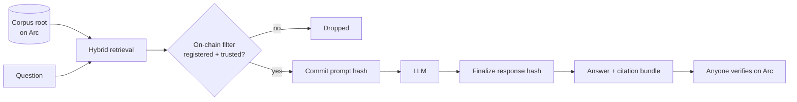
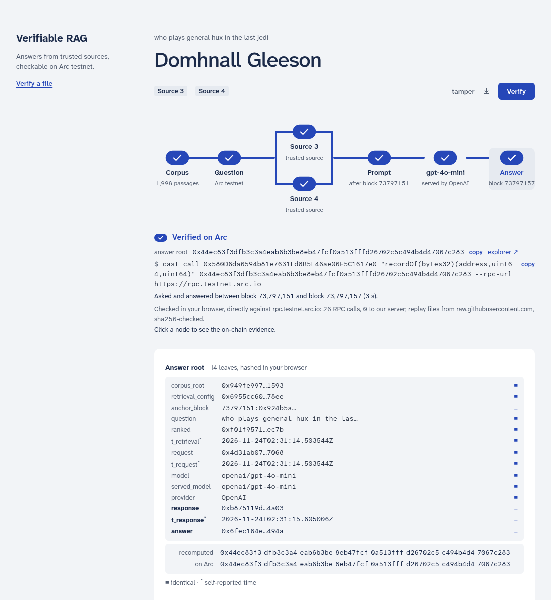
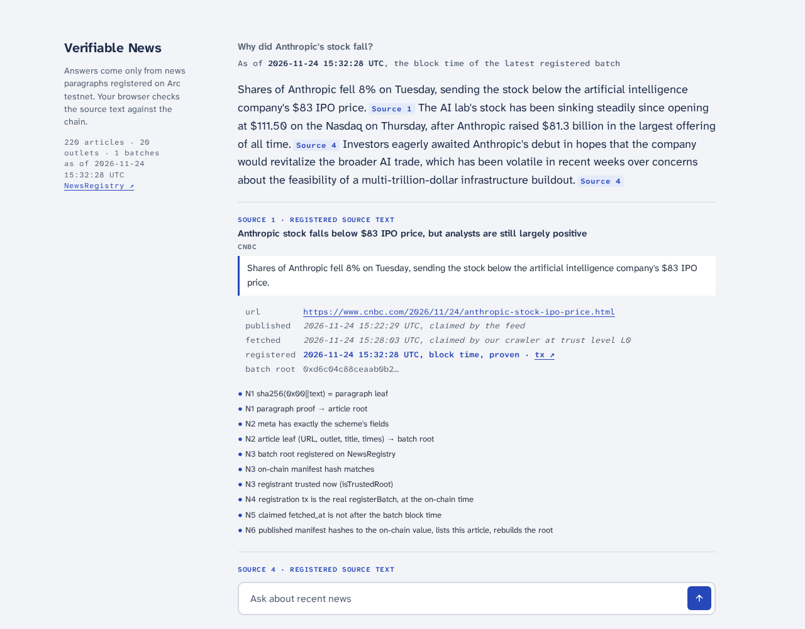

# Onchain Verifiable-Source RAG

**Situation.** RAG answers can hallucinate, and an attacker can poison the corpus with fake passages ([PoisonedRAG](https://arxiv.org/abs/2402.07867)). A user who doesn't trust the service has no way to check where an answer came from.

**Task.** Make the model answer only from trusted sources, and let anyone check, without trusting us, that the cited passages are genuine and were actually in the prompt.

**Action.**
- Trusted documents are hashed (SHA-256) and registered on **Arc testnet** in `SourceRegistry`. A passage counts as *verified* only if it is registered **and** its registrant is on a trusted-publisher allowlist.
- Retrieval (hybrid BM25 + dense) keeps only verified passages, checked live on-chain.
- Each model call goes into `InferenceLog`. The hash of the exact prompt bytes and of the passage set is committed *before* the call. The hash of the exact response bytes is finalized *after* it, in a later block.
- Anyone can verify an answer bundle **in their own browser**, directly against the public Arc RPC (zero calls to our server): the citation hashes, their registration and trusted publisher, that the cited text was in the committed prompt, and that the answer matches the logged response.
- The whole corpus (all 1,998 passages the retriever searches) is committed as a Merkle root in `CorpusRegistry`, together with the hash of the exact retriever (code, embedding weights, parameters). Each answer binds its full ranked candidate list into the committed prompt. The verifier checks an inclusion proof for every candidate, then **replays retrieval in the browser** over the committed corpus and requires the identical ranking. A document hidden from the ranking shows up red.
- The verifier also checks that the requested model matches its committed hash. It reads the served model and provider from the hashed response, so silent routing to another model shows up as a red check.

**Result** (30 PoisonedRAG NQ questions, gpt-4o-mini):

| | hallucination | fakes reaching the model |
|---|---|---|
| poisoned corpus, no filter | 0.90 | 4.97 / 5 |
| naive "is registered" filter (attacker registers its own fakes) | 0.90 | 155 / 155 pass |
| **verified-only (trusted publishers)** | **0.13** | **0 / 155 pass** |

- The on-chain filter takes about 180 ms per question (50 candidates, one call).
- Tampered bundles (an edited passage, an edited prompt, an altered answer, a fake citation) all fail verification.
- A dishonest server that drops the best trusted document *and commits consistently* passes every hash check, but fails the replay. A passage that isn't in the corpus fails its inclusion proof.

**Contracts (Arc testnet, chain 5042002)**
- SourceRegistry: [`0x9350E7E458abe568B40c1Fc28c66dE674865878e`](https://explorer.testnet.arc.io/address/0x9350E7E458abe568B40c1Fc28c66dE674865878e)
- InferenceLog: [`0xc7CfFb4Ae006AccC82813829CCC466B964aBCAE3`](https://explorer.testnet.arc.io/address/0xc7CfFb4Ae006AccC82813829CCC466B964aBCAE3)
- CorpusRegistry: [`0x1Fb5aDDb3CdB5DE1945f3Ab32c7FF0b6d2CDA2de`](https://explorer.testnet.arc.io/address/0x1Fb5aDDb3CdB5DE1945f3Ab32c7FF0b6d2CDA2de) (corpus v1, root `0x949fe997…ed81593`)

**Verify it yourself.** Open [`verify.html`](verify.html), a single local file that needs no server and talks only to `rpc.testnet.arc.io` (plus the hash-checked corpus and model files on GitHub for the replay), and drop in a bundle. Every check shows the raw RPC request and response, plus a `cast` command that reproduces it.

**Limitation.** The log proves which exact prompt and response existed and when, and that the cited sources are genuine. It does not prove that the provider actually ran the model on that prompt, and it does not verify the model's reasoning. The served model and provider are self-reported by the provider, not cryptographically proven. The replay proves the ranking follows from the committed corpus and retriever. It doesn't prove the corpus itself is complete or unbiased, and the trust filter is re-checked against the current allowlist.

## Verifiable news answers

The [`news` folder](news/README.md) applies the same checks to live news. A crawler reads 20 English news feeds every hour. Every 8 hours, it registers a Merkle root of the new articles in `NewsRegistry` on Arc testnet at [`0x124FcEfe59dAdbE5f6517E709b5C6A3988Ab6F64`](https://explorer.testnet.arc.io/address/0x124FcEfe59dAdbE5f6517E709b5C6A3988Ab6F64).

A passing news bundle proves two things:

1. Every cited paragraph comes from an article in a batch that a trusted key registered. The text, URL, and claimed times are inside the batch root.
2. The cited paragraphs were in the prompt that the server committed on-chain before the model call. The response hash was finalized in a later block.

A passing bundle does not prove that the news is true. It does not prove that no relevant article was left out, because full article text can't be published. You also trust our crawler key for what each page said when we fetched it.

