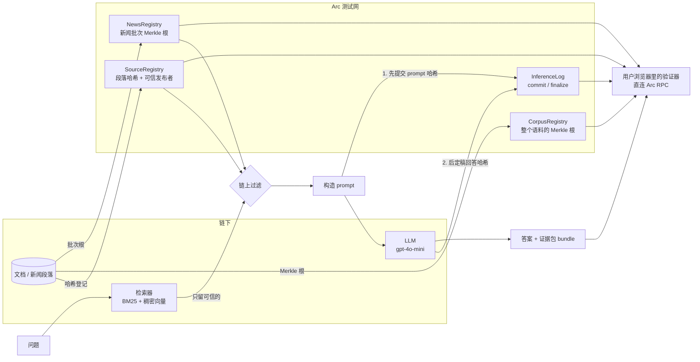

# 让 AI 说清楚话从哪来：在 Arc 测试网上做一个"来源可验证"的 RAG

> 这是 Onchain Verifiable-Source RAG 项目的开发笔记。代码在 [xhu703981/onchainverifiableRAG](https://github.com/xhu703981/onchainverifiableRAG)，所有合约都部署在 Arc 测试网（chain id 5042002），没有上主网。文中的地址、交易哈希、数字都来自仓库里的文件（`README.md`、`experiments/results.md`、`news/deployment.json`、`news/examples/*.json` 等）。

---

## 一、起点：我们到底想解决什么

### AI 是一个黑盒

你问一个 AI 助手"为什么 Anthropic 的股价跌了"，它给你一段很流畅的回答，后面挂着几个"来源"。问题是，你没法知道：

- 这些来源是不是真的存在，文字有没有被改过；
- 模型回答之前，是不是真的读到了这些文字；
- 服务方有没有偷偷往资料库里塞了东西，或者把一篇不利的文章藏起来；
- 回答你的到底是不是它声称的那个模型。

RAG（Retrieval-Augmented Generation，检索增强生成）是现在最常见的让 AI "有据可查"的做法：先从资料库里检索几段相关文字，把它们塞进 prompt，再让模型回答。但 RAG 本身并不解决信任问题。资料库可以被污染：[PoisonedRAG](https://arxiv.org/abs/2402.07867) 这篇论文就演示了，往语料里注入几段精心编写的假文字，就能让模型几乎每次都给出攻击者想要的答案。

### 区块链能做什么

我们的直觉是：区块链最优雅的地方，不在于币，而在于它让互不信任的各方，可以不经过任何中间人，自己去核对一件事。链上的数据谁都能读，写进去就改不了，每条记录都有一个大家公认的时间。

所以这个项目的目标不是"让 AI 更聪明"，也不是做一个看起来很厉害的东西，而是：**把 AI 回答过程中那些可以被客观核对的环节，变成任何人都能在自己浏览器里验证的事实。**

### 我们不验证真相

这一点在做新闻版本的时候说得最清楚。真相很难验证，也不该由一个程序来裁决。我们要验证的是一件更朴素的事：

> AI 告诉你的信息，确实来自你愿意相信的那些来源；它引用的文字，确实是那些来源原本写的；模型在回答之前，确实读到了这些文字。

更进一步，"信任谁"应该是每个人自己的选择。有人信 BBC，有人信 Fox News，有人只信 NPR。每个人选自己信的来源，得到的答案可能不一样。这没关系，系统要保证的是"你选的就是你得到的"，而不是替你选。按来源筛选这一步还没完全做完（后面会讲），我们先把整条链的证明过程打牢。

---

## 二、整体架构

先看全貌。项目有两个演示：

- **8765 端口的主演示**：在 PoisonedRAG 的问答数据上，证明"只用可信来源"能把幻觉率从 0.90 压到 0.13。
- **8766 端口的新闻演示**：每小时抓 20 家英文媒体的 RSS，每 8 小时把新文章的 Merkle 根登记上链，回答新闻问题时每句话都要引用已登记的段落。



链上只存哈希和少量元数据，原文留在链下。用户拿到的是一个 **bundle（证据包）**：一个 JSON 文件，里面有答案、引用的原文、Merkle 证明、发给模型的完整请求字节、模型返回的完整响应字节，以及相关交易的哈希。验证器只需要这个文件和一个公开的 Arc RPC 节点，不需要问我们的服务器任何问题。

四个合约的地址：

| 合约 | 地址 | 作用 |
|---|---|---|
| SourceRegistry | `0x9350E7E458abe568B40c1Fc28c66dE674865878e` | 段落哈希登记 + 可信发布者白名单 |
| InferenceLog | `0xc7CfFb4Ae006AccC82813829CCC466B964aBCAE3` | 每次模型调用的两阶段日志 |
| CorpusRegistry | `0x1Fb5aDDb3CdB5DE1945f3Ab32c7FF0b6d2CDA2de` | 整个检索语料的 Merkle 根和检索器配置 |
| NewsRegistry | `0x124FcEfe59dAdbE5f6517E709b5C6A3988Ab6F64` | 新闻批次的 Merkle 根 |

Arc 是一条用 USDC 付 gas 的链，测试网 RPC 是 `https://rpc.testnet.arc.io`，浏览器是 `explorer.testnet.arc.io`。

下面按时间顺序，一块一块讲。

---

## 三、第一块砖：SourceRegistry，"登记了"不等于"可信"

### 想法

最简单的想法是：把每段可信文字的 SHA-256 哈希写到链上。检索时，只用哈希在链上能查到的段落。

SHA-256 是一种哈希函数：任何一段文字进去，出来一个 32 字节的"指纹"。改一个字符，指纹就完全不同；从指纹反推原文在计算上不可行。所以链上存指纹，就等于把原文"钉"住了，又不用公开原文。

### 第一个坑：攻击者也能登记

但这个想法有个明显的漏洞：登记是开放的（permissionless），任何人都能往合约里写哈希。攻击者完全可以把自己的假段落也登记上去。

我们在实验里真的这样做了。攻击者钱包 `0x701986C6A9402e39093c66Bf6Ab93A102ffa9776` 不在白名单里，它把 PoisonedRAG 的 500 段假文字全部登记上链。结果，一个只检查 `isRegistered`（"登记过没有"）的天真过滤器，155 段进入候选的假文字 **155 段全部通过**，幻觉率还是 0.90。

### 解决：把"登记"和"信任"拆开

所以 SourceRegistry 把两件事分开：

- **登记**：谁都可以做。记录内容哈希、IPFS CID、登记人地址和区块时间。
- **信任**：合约 owner 维护一个 `trustedPublishers` 白名单。

检索时调用的是 `isVerified(hash)`：哈希已登记，**并且**登记人当前在白名单里。批量版本 `areVerified(bytes32[])` 一次 `eth_call` 就能查 50 个候选，实测中位数大约 180 毫秒。

合约还提供 `cidOf(digest)`，在链上把 SHA-256 摘要编码成 IPFS 的 CIDv1（raw codec 0x55，base32），和 `ipfs add --cid-version 1 --raw-leaves` 的结果一致。这样一段文字在 IPFS 上的地址也能从链上推出来。

为了省 gas，后来加了批量登记路径 `registerBatch`，每个哈希只占一个存储槽（登记人 + 时间）。1,498 段干净文字分 7 笔交易登记，用了 38,889,017 gas，约 0.8167 测试网 USDC，平均每个哈希约 25,961 gas。

---

## 四、幻觉测试：0.90 → 0.13

有了"已验证"过滤，我们在 PoisonedRAG 的 Natural Questions 子集上跑了一次对照实验（30 个问题，生成和判分都用 gpt-4o-mini）：

| 条件 | 幻觉率 | 进入模型的假文字 |
|---|---|---|
| 被污染的语料，不过滤 | 0.90 | 平均每题 4.97 / 5 |
| 天真过滤 `isRegistered`（攻击者登记了自己的假文字） | 0.90 | 155 / 155 通过 |
| **只用已验证（可信发布者）** | **0.13** | **0 / 155 通过** |

0.13 正好等于"干净语料、没有任何假文字"时的幻觉率。也就是说，过滤器把攻击完全挡住了，剩下的错误是模型自己的。比如 NHL waivers 那道题，模型在上下文里一段假文字都没有的情况下答了"48 hours"，碰巧和攻击者设定的答案一样。

检索是混合检索：BM25（经典的关键词打分）加稠密向量（把文字变成向量算相似度），两边的排名用 RRF（Reciprocal Rank Fusion，倒数排名融合）合并，取前 50 个候选，过滤后取前 5 个进 prompt。

实验也有清楚的边界：n=30，每个比率大约有 ±0.15 的不确定性；它只测试了"不可信的人往库里塞东西"这一种威胁。如果可信发布者自己发了错误内容，过滤器挡不住。

---

## 五、InferenceLog：先提交 prompt，再定稿回答

### 想法

来源可信只解决了一半。另一半是：你怎么知道模型真的读了这些来源？服务方完全可以给你看一份漂亮的引用列表，实际上发给模型的是另一份 prompt。

我们的做法是把每次模型调用分成两笔链上交易：

1. **commit（调用模型之前）**：把发给模型的**完整 HTTP 请求体**的 SHA-256 写上链。请求体里有模型名、参数、完整 prompt（含所有段落原文）和一个客户端时间戳。同时写入 `passagesRoot`（按 prompt 顺序把各段哈希拼起来再哈希）、`modelHash`（模型名的哈希）、`questionId` 和段落数量。
2. **finalize（模型回答之后）**：把模型返回的**原始响应字节**的 SHA-256 写上链。

合约里有一条关键的规则：

```solidity
if (block.number <= r.commitBlock) revert SameBlockAsCommit(answerId);
```

finalize 必须在 commit **之后的区块**。每个 `answerId` 只能 commit 一次、finalize 一次。只有白名单里的 logger 能写。

请求体的序列化方式是固定的：`json.dumps(body, sort_keys=True, separators=(",", ":"), ensure_ascii=False)`，也就是键排序、无空格的规范 JSON。这样验证者拿到 bundle 里的 `request_body` 字符串，自己算一遍 SHA-256，就能和链上的 `requestHash` 逐字节对比。

### 为什么要锁定顺序

两笔交易、两个区块，换来的是一个由链本身担保的顺序："这份 prompt 在这个回答被记录之前就已经确定了。"服务方不能先看到回答再回头改 prompt，因为 prompt 的哈希早就在更早的区块里了。

### 一次被撤回的设计

中间我们试过另一种方案（commit c762cfb）：每个回答只上链一个 32 字节的根，把问题、prompt、回答、锚定区块、各步骤时间等 14 个带标签的叶子做成 Merkle 树，只发一笔交易，更便宜也更"整洁"。

但这个方案丢掉了最重要的东西。一笔交易只能在回答出来之后才发，"prompt 先于回答"变成了叶子里自报的时间，而不是链上两个区块的先后。省下一笔交易，却把一个链证明的事实换成了一个自我声明。所以我们在 4e72668 把它撤回了，回到两笔交易。这个取舍后来成了整个项目的一条原则：**能由链证明的顺序，不降级成自报的字段。**

### 模型换没换

验证器还会从（已经被哈希钉住的）响应体里读出实际服务的模型名和 provider，和请求的模型比较（检查 M6）。如果 OpenRouter 悄悄把请求路由到了另一个模型，这一项会变红。要注意，served model 和 provider 是 provider 自己报的，不是密码学证明。

每个问题的成本：commit + finalize 大约 0.005 测试网 USDC 的 gas，加上大约 $0.0001 的 gpt-4o-mini 调用费。

---

## 六、浏览器端验证器：不需要相信我们的服务器

### 想法

如果验证要跑在我们的服务器上，那等于让用户"相信我们说我们是可信的"，绕了一圈回到原点。所以验证必须在用户自己的浏览器里完成，直接连公开的 Arc RPC。

### 实现

- `webdemo/static/arcverify.js` 是 Python 验证器 `verify_citations.py` 的浏览器移植版。SHA-256 用浏览器自带的 WebCrypto，keccak（以太坊函数选择器和事件 topic 用的哈希）用随仓库附带的 @noble/hashes 1.8.0。
- 所有链上读取都是对 `rpc.testnet.arc.io` 的 JSON-RPC 调用：`eth_chainId`、`eth_getCode`、`eth_call`、`eth_getTransactionByHash`、`eth_getTransactionReceipt`、`eth_getBlockByNumber`。
- 页面会统计验证期间有多少请求打到了自己的服务器，验证结束后在图下方写一行："Checked in your browser, directly against rpc.testnet.arc.io: N RPC calls, 0 to our server."（在你的浏览器里直接对 Arc RPC 检查：N 次 RPC 调用，0 次发给我们的服务器。）字体也是提前加载好的，就是为了让这个 0 是真的 0。
- `verify.html` 是一个单文件版本，所有脚本内联，可以直接从 `file://` 打开。它的 CSP（内容安全策略）只允许访问 `rpc.testnet.arc.io` 和 `raw.githubusercontent.com`（后者只用来下载重放所需的语料文件，下载后都会校验 SHA-256）。
- 每一项检查在证据面板里都附带原始 RPC 请求和响应，以及一条可以在终端复现的 `cast rpc ...` 命令。不想用浏览器，也可以 `python verify_citations.py bundle.json`，退出码 0 表示全部通过。
- 浏览器版和 Python 版的一致性由 `webdemo/parity/` 下的脚本检查（Node 和无头 Chrome 各一套）。

---

## 七、CorpusRegistry：把整个语料钉在链上，然后在浏览器里重放检索

### 新的漏洞：藏起来

到这一步，我们能证明"引用的段落是真的、可信的、确实在 prompt 里"。但还有一种作弊没法发现：服务方可以**把最相关的那段可信文字藏起来**，只给模型看次优的几段，然后把一切都诚实地 commit 上链。每个哈希都对得上，但答案被操纵了。

### 解决：承诺语料 + 承诺检索器 + 重放

1. **整个语料做成 Merkle 树**。检索器搜索的全部 1,998 段文字（1,498 段真的 + 500 段攻击者的假文字，假的也算进去，因为语料就应该是检索器真实搜索的范围；信任过滤在检索之后，由 SourceRegistry 负责）。
   - 叶子 = sha256(0x00 ‖ passageHash)，其中 passageHash = sha256(段落 UTF-8 文本)
   - 内部节点 = sha256(0x01 ‖ 左 ‖ 右)
   - 叶子按 passageHash 升序排列；一层末尾落单的节点原样升到上一层（不复制）
   - 0x00 / 0x01 这种前缀叫**域分离**（domain separation）：保证一个叶子哈希不可能被伪装成内部节点，堵住一类经典的 Merkle 树伪造攻击。
   - 根是 `0x949fe997d49adee6daa0165f3c30faaf109086919121b0cef125b1b94ed81593`，每个证明最多 11 个兄弟节点。
2. **检索器本身也承诺**。`retrieval_config_v1.json` 里钉住了语料文件、检索器代码 `retrieval_v1.py`、嵌入模型（model2vec potion-base-8M）权重和分词器的 SHA-256，以及每个参数（BM25 的 k1/b/停用词、WordPiece 规则、RRF 的 k、候选深度 50、prompt_k 5）。这个文件的哈希就是链上的 `configHash`。
3. **链上 URI 指向一个不可变的 GitHub commit**（636dfc3）。托管方不需要可信，因为每个文件下载后都要和配置里的哈希比对。
4. **每个回答把完整的排名列表绑进 prompt**。prompt 的元数据行里写着 `corpus=v1:<根>`、`retrieval_config=<配置哈希>`、`retrieval=sha256(排名列表)`，这一行在 commit 时就被哈希上链了。

验证时，浏览器会下载承诺的语料、权重、分词器和代码（约 31 MB，每页一次，都校验哈希），在浏览器里重建索引（约 0.4 秒），重新跑一遍检索，要求得到**完全相同**的排名。

为了让 Python 和 JavaScript 跑出一模一样的结果，所有计算用 float64，排序用量化到 1e-9 的分数，平分时按叶子序号排。JS 移植版 `static/replay.js` 在 420 个测试查询上和 Python 参考实现给出相同的 id、名次和 RRF 分数，WordPiece 分词在全部 1,998 段上和 HuggingFace `tokenizers` 一致。

仓库里有两个真实的"不诚实服务器"反例（都是真实的模型调用和链上记录）：

- `bundle_corpus_hide.json`：丢掉了最好的可信候选，然后一致地提交了一切。所有哈希检查都通过，**只有重放失败**："replay ranks 0xe400687334... at #6, but the answer's list omits it"。
- `bundle_corpus_inject.json`：排了一段不在语料里的文字，**包含证明失败**。

---

## 八、UI 重设计：一条"保管链"，以及 Source N

### 想法

验证结果如果只是一长串绿勾，用户是看不懂的。我们想要的是一张图，让人一眼看出"从问题到答案，证据是怎么一环扣一环传下来的，在哪一环断了"。

这就是**保管链（chain of custody）图**。这个词来自司法取证：证物从现场到法庭，每一次交接都要有记录，任何一环缺失，证物就不可采信。

### 设计细节

- 图从左到右是几列节点，节点之间是"链环"。一列全部通过，链环闭合，蓝色带勾；有一个失败，链环断开，红色带叉。通过与失败不只靠颜色区分，还靠形状（闭合的环 vs 有缺口的环），色弱用户也能分辨。
- 字体用 Atkinson Hyperlegible（为低视力读者设计的字体），配色是偏冷的"安全纸"色调，钴蓝表示通过，暗红表示失败。
- 验证时节点按列依次点亮，第一个失败的节点会在图下方给出一句人话解释，比如"text was changed: its hash no longer matches the chain"（文字被改过，哈希和链上对不上了）。
- 点任何一个节点，下方展开这个节点的证据面板。
- 段落编号 P1、P3 在界面上显示为 "Source 1"、"Source 3"。这只是显示层的替换，bundle、prompt 和哈希里仍然是 P 编号，因为改了它们就会改变被哈希的字节。

---

## 九、新闻注册表：把同样的检查搬到真实新闻上

前面的一切都在一个固定的问答数据集上。真正有价值的场景是新闻：这是一个人们普遍存在信任问题的行业。于是有了 `news/` 这一部分。

### 9.1 抓取：20 家英文媒体

`news/sources.json` 列出 20 个 RSS 源：BBC News、The Guardian、NPR、Al Jazeera、Deutsche Welle、France 24、CNBC、The Conversation、ProPublica、Global Voices、Fox News、RTE News、Euronews、TechCrunch、Ars Technica、The Verge、NASA、Phys.org、UN News、The Straits Times。

它们是从 35 个候选里用"抓取 + 提取"测试挑出来的。被淘汰的原因都记在文件里：Sky News、The Hill、Politico、Axios 对爬虫返回 403；CNN 的 feed 返回 500；CBC 超时；PBS 提取出 0 个段落；The Independent 的 feed 是空的；CBS 很多条目只有视频。

`newsreg.crawl` 大约每小时跑一次，保存每篇文章的**原始 HTML 字节**。抓取藏在一个 `Fetcher` 接口后面，目前的实现是普通的 `HttpFetcher`。以后换成能证明 TLS 会话的 zkTLS fetcher，其他代码都不用动。

几个工程上的小坑：lxml 提取在多线程下会段错误，所以提取只在单进程里跑；UN News 的服务器会不请自来地返回 gzip 压缩的内容，导致解析出 0 条，所以 fetcher 会主动解压。

版权方面：全文只留在本地数据库里做验证，**从不重新分发**。公开的 manifest 只有标题、URL 和哈希。

### 9.2 提取与规范化：让哈希可以复现

哈希要能复现，前提是"从一个网页得到哪些段落"必须是确定的。`news/NORMALIZATION.md` 把规则写死：

1. 输入是 fetcher 保存的原始响应字节，不做任何修改。`raw_html_sha256` 就是这些字节的哈希。
2. 用固定参数调用 trafilatura（一个正文提取库）：`favor_precision=True`，不要评论、表格、图片、链接、格式。所有依赖的版本钉在 `news/requirements.lock` 里。`extractor_version` 形如 `trafilatura-2.0.0/lock-af7fbee8237b3de9`，后半段是 lock 文件哈希的前 16 位。
3. 按换行切段，每段做 Unicode NFC 规范化，把所有连续空白压成一个 ASCII 空格，去掉空段。
4. 少于 3 段或总长少于 400 字符的文章（视频页、直播页、预告）不进批次。

最巧妙的一点是：**这份规范文件自身的 SHA-256，就是每篇文章 meta 里的 `normalization` 字段**（当前是 `0xa776a1dd…`）。改规范的一个字节，就是一个新的规范版本，旧批次不受影响。为了保证文件逐字节不变，`.gitattributes` 里给它标了 `-text`，不让 git 改换行符。

我们手工抽查了第一批的 30 篇文章（`news/SPOTCHECK.md`）：23 篇完全干净，7 篇带一行残留（比如 Straits Times 的 "AI generated" 标签、NPR 的编辑署名行、BBC 的 "- Published"），没有导航菜单、广告或"相关阅读"。我们决定不为此改规则，因为改规则就是一个新的规范版本，而第一批已经在这个版本下登记了。

### 9.3 域分离的 Merkle 树：news-merkle-v1

新闻的树有三层：段落 → 文章 → 批次。

```
段落叶子 = sha256(0x00 ‖ 段落文本)
内部节点 = sha256(0x01 ‖ 左 ‖ 右)
文章根   = 该文章所有段落叶子的 Merkle 根
文章叶子 = sha256(0x02 ‖ sha256(JCS(meta)) ‖ 文章根)
批次根   = 所有文章叶子（按 manifest 顺序）的 Merkle 根
```

- 落单的节点原样上升；只有一个叶子的树，根就是那个叶子。
- 0x02 是文章叶子独有的前缀，所以文章叶子不可能和段落叶子或内部节点混淆。
- **meta** 是文章的元数据：`url`、`outlet`、`title`、`published_at`、`fetched_at`、`extractor_version`、`normalization`、`raw_html_sha256`、`version`。
- **JCS** 是 RFC 8785 定义的 JSON 规范化格式：键排序、固定的数字和字符串写法，保证同一个对象在任何语言里序列化出相同的字节。我们在对抗性审查时发现一个细节：浏览器会把 `1.0` 写成 `1`，Python 会写成 `1.0`，于是让 Python 也把整数值的浮点数写成整数，两边一致。
- URL 先规范化：协议和主机小写，去掉默认端口和 `#` 片段，去掉 `utm_*`、`fbclid`、`gclid` 等追踪参数。文章按规范化后的 URL 和文章根去重。
- 证明是一串 `"L:0x…"` 或 `"R:0x…"`，从下往上，标明兄弟节点在左边还是右边；节点直接上升的那一层不产生步骤。

这样一来，**一段话的文字、它所在文章的 URL、媒体名、标题、时间，全部被一个 32 字节的批次根绑在一起**。改其中任何一个，证明都到不了根。

### 9.4 NewsRegistry 合约

`contracts/NewsRegistry.sol` 很小，沿用了 SourceRegistry 的"登记开放、信任靠白名单"模式：

- `registerBatch(root, manifestHash, articleCount, uri)`：登记一个批次根，记下 manifest 的哈希、登记人、文章数、区块时间和 manifest 的 URI。
- `isTrustedRoot(root)`：已登记，**并且**登记人**当前**在白名单里。
- `areTrustedRoots(roots[])`：一次调用检查整个检索范围。
- `getBatch(root)`：返回 `exists, manifestHash, registrant, articleCount, timestamp, uri`。

有一条特别的规则：**防抢注**。manifest 是在交易之前就推到 GitHub 上的，任何人看到之后都可以抢先用自己的（不可信的）地址登记这个根，让它永远处于"不可信"状态。所以合约允许：如果一个根当前由不可信地址持有，可信发布者可以接管它；其他情况下重复登记一律 revert。Foundry 测试 `test_trustedReclaimsSquattedRoot` 覆盖了这个场景。

部署信息在 `news/deployment.json`：部署交易 `0xabad7f18…`，区块 73888185。部署是用 Python 的 eth_account 做的，而不是 `forge create --private-key`，目的是不让私钥出现在进程参数里。

### 9.5 批次登记与公开 manifest

`newsreg.register` 每 8 小时跑一次：

1. 把还没进批次的合格文章组成一个批次，算出批次根。
2. 生成 **manifest**：`{scheme, batch_root, article_count, created_at, articles: [{meta, article_root}]}` 的 JCS 形式。它只有元数据和根，没有正文。
3. 把 manifest 推到仓库独立的 `news-manifests` 分支（通过 git worktree，定时任务永远不碰 main 分支和工作区）。
4. 把批次根和 manifest 哈希登记到 NewsRegistry。

第一批在部署后立即登记：220 篇文章，交易 `0xd765fb5385…`，区块 73889005，批次根 `0xd6c04c88ce…`。

登记任务是**幂等**的：构建批次和分配文章在同一个数据库事务里完成；之后每次运行都会把"已构建未登记"的批次补登记，如果链上已经有我们的 key 登记了这个根，就跳过交易。这是因为如果在交易上链之后、数据库更新之前崩溃，旧逻辑会把同一批文章再登记一次。这个问题是先写出失败的测试（`tests/test_register_idempotent.py`）再修的。

### 9.6 回答规则与弃权

`newsreg/engine.py` 回答一个新闻问题的流程：

1. **确定范围**：读取数据库里所有已登记的批次，用 `areTrustedRoots` 在链上筛出当前可信的。把这些批次根排序去重后拼起来做 SHA-256，得到 `scope_hash`。
2. **截止时间检查**：如果问题里有晚于截止时间的明确日期（年份、月+年、月+日），或者出现 "tomorrow"、"next week/month/year"，直接弃权，**不调用模型**。例子：`Who won the 2027 Super Bowl?` → "2027 is after the corpus cutoff 2026-11-24"。
3. **检索**：在可信范围内所有段落上做同样的 BM25 + 稠密向量 + RRF 混合检索。
4. **相关性门槛**：一个候选只有同时满足"问题关键词覆盖率 ≥ 0.4"和"向量余弦相似度 ≥ 0.35"才算相关。这两个阈值是在 8 个问题上调出来的。一个都不相关就弃权，也不调用模型。例子：`What is the boiling point of tungsten?`（钨的沸点）→ "best candidate coverage 0.33, cosine 0.19"。
5. **构造 prompt**：取前 6 个相关段落，标成 [P1]…[P6]。指令要求 1 到 4 句话，**每一句都要在句号前标出支持它的段落编号**，不允许写没有引用的句子；如果段落回答不了，或者问的是截止时间之后的事，就原样回复 "Not found in registered news."。
6. **commit → 调用模型 → 等到下一个区块 → finalize**，和主演示完全一样。

弃权回答统一是 `Not found in registered news.`。页面上会写明"No model call was made"（没有调用模型）以及原因。

有个小插曲：一开始 prompt 示例里写的是 "[P2] or"，结果验证器解析 prompt 时把这个示例也当成了一个段落，数出 7 段而不是 6 段，M3 检查失败。改成 "[P2]." 之后才通过。

### 9.7 "as of"：被证明的时间 vs 被声称的时间

新闻里时间非常重要，我们对每个时间都标明了它的性质：

- **`as_of`**：检索范围内最新批次的**区块时间**。这是唯一被链证明的时间，含义是"这些文章最晚在这个时刻已经存在"。页面顶部写着 "As of …, the block time of the latest registered batch"。
- **`published_at`**：RSS feed 声称的发布时间。页面标注 "claimed by the feed"（由 feed 声称）。
- **`fetched_at`**：我们爬虫声称的抓取时间。页面标注 "claimed by our crawler at trust level L0"（由我们的爬虫声称，信任级别 L0）。
- **registered**：批次登记交易的区块时间，标注 "block time, proven"（区块时间，已证明），旁边有交易链接。

验证器会检查 `fetched_at` 不晚于批次的区块时间（检查 N5）：爬虫不可能声称在登记之后才抓到一篇已经登记的文章。

**L0** 是我们给信任级别起的名字：爬虫的 key 就是登记人，你需要相信这个 key 如实记录了抓取时网页上写的东西。更高的级别（比如用 zkTLS 证明网页确实是从 bbc.co.uk 返回的）留到以后。

### 9.8 信任撤销的语义

`isTrustedRoot` 读的是**当前**的白名单。如果 owner 把一个 key 从白名单里移除，这个 key 过去登记的**所有**批次都会立刻变成不可信。这是有意为之：如果爬虫的 key 泄露了，可以一次性追溯撤销它登记过的一切。代价是：一个今天通过验证的 bundle，明天可能因为撤销而不通过。

我们也专门做了一个真实的反例：用一个临时 key（`0xe78B05339E36afD728B7E3c7514713Bb40d14bED`，不在白名单里）在链上登记了一个 3 篇文章的批次（交易 `0xe5c99fb4…`），记录在 `news/examples/untrusted_batch.json`。这样"不可信"的失败测试是基于链上真实存在、但登记人不可信的批次，而不只是一个查不到的记录。

### 9.9 范围绑定：搜了哪些批次，也在调用模型之前定下来

新闻语料不能公开全文，所以没法像主演示那样让用户重放检索。但我们至少可以把"这次检索搜了哪些批次、用的什么配置"在调用模型之前钉住。prompt 的系统消息里有这样一行（来自 `news/examples/bundle_genuine.json`）：

```
Request metadata (audit only, do not mention): answer_id=0x00deafcd…; question_id=0xcba729c8…;
client_ts=2026-11-24T15:36:23.837830Z; news_registry=0x124FcEfe59dAdbE5f6517E709b5C6A3988Ab6F64;
scheme=news-merkle-v1; news_scope=0xcb4c45bf…; retrieval_config=0x83af75fb…; as_of=2026-11-24T15:32:28Z
```

这一行是请求体的一部分，请求体的哈希在 commit 交易里。所以范围、配置、截止时间都在模型回答之前就上链了。InferenceLog 合约和 M 系列检查完全不用改。

---

## 十、逐节点讲解：点开每个节点，每一行是什么意思

下面用真实的 bundle 来讲。主演示用 `webdemo/data/example_bundle.json`（问题 "who plays general hux in the last jedi"，答案 "Domhnall Gleeson"，引用 P3 和 P4，commit 在区块 73776187，finalize 在区块 73776191）。新闻演示用 `news/examples/bundle_genuine.json`（问题 "Why did Anthropic's stock fall?"，引用 CNBC 文章的 P1 和 P4，commit 在区块 73889470，finalize 在区块 73889480）。

### 10.0 每个证据面板的通用结构

点开任意节点，面板最多有四部分：

1. **Checks（检查项）**：这个节点负责的每一项检查，实心点表示通过，叉表示失败，空心圈表示跳过（比如 manifest 下载失败）。失败的检查会附上细节。检查名前面的编号（M2、N1 等）在显示时去掉了。
2. **Recomputed in your browser, against the chain（在你的浏览器里重新计算，与链上对比）**：两种卡片。
   - 对比卡：`local`（本地算出的值）和 `on-chain`（链上读到的值，有的是 `bundle`），哈希按 8 位一组显示，不同的字符加粗下划线。右上角写 `≡ identical`（完全相同）或 `≠ differs`（不同）。`shell` 一行给出一条可以在终端复现的命令，比如 `jq -j .inference.request_body bundle.json | sha256sum`。
   - 事实卡：`value` 是一个值，右上角写 `confirmed` 或 `not confirmed`，下面一行注释。
3. **Raw RPC, direct to rpc.testnet.arc.io（原始 RPC，直连）**：这个节点用到的每一次 RPC 调用，可以展开。标题行是序号、方法名、函数签名（比如 `getBatch(bytes32)`）和耗时。展开后是 `request`（完整的 JSON-RPC 请求）、`response`（节点返回的原始结果）、`reproduce`（等价的 `cast rpc` 命令）和 `explorer`（区块浏览器链接）。
4. 主演示的 Corpus 节点额外有 **Inclusion proof** 和 **Replay** 两部分（见下）。

### 10.1 主演示（8765）的六列

主演示的链是：**Corpus → Question → Source N → Prompt → 模型 → Answer**。

#### Corpus（副标题："1,998 passages"）

检查项：

- **CorpusRegistry has code**：这个地址上确实部署了合约（`eth_getCode` 不为空）。
- **on-chain corpus version matches the bundle (root, leaf count, config hash)**：`corpusInfo(1)` 读出的根、叶子数、配置哈希和 bundle 里写的一致。细节显示 "v1 · 1998 leaves"。
- **corpus published by an authorized publisher**：发布这个版本的地址在 `isPublisher` 里。
- **publish tx emitted CorpusPublished(version, root)**：发布交易成功，且发出了版本号和根都对得上的事件。
- **sha256(retrieval config) == on-chain configHash**：bundle 里附带的配置 JSON，哈希等于链上的配置哈希。
- **corpus, config and ranked-list hashes are inside the hashed request**：prompt 的元数据行里有 `corpus=v1:<根>`、`retrieval_config=<哈希>`、`retrieval=<排名列表哈希>`，而这一行在 commit 时就被哈希了。
- **every ranked candidate has a valid inclusion proof against the on-chain root**：50 个候选每一个都有 Merkle 证明能到达链上的根。细节写 "50 of 50 proofs valid"。
- **every prompt passage is a ranked candidate**：进 prompt 的段落都来自排名列表。
- **prompt = the first k verified candidates in rank order (none skipped)**：用 `areVerified` 在 SourceRegistry 上查这 50 个候选，按名次取前 5 个已验证的，必须正好等于 prompt 里的 5 段。这一项堵住了"跳过某个可信候选"。
- **fetched corpus, retriever code, weights and tokenizer match the committed config**：重放下载的四个文件，哈希都和配置一致。
- **Merkle root of the fetched corpus == on-chain root**：下载的语料重建出的根等于链上的根。
- **replaying the committed retriever gives the same ranked candidates**：重放得到的候选 id 和顺序完全相同。
- **replay query == bundle question**：重放用的查询就是 bundle 里的问题。

**Inclusion proof** 部分展示第一个被引用段落的完整 Merkle 路径："Inclusion proof for Source 3, leaf … of 1,998"。逐行是：`passage`（段落哈希）、`leaf`（加 0x00 前缀后的叶子哈希）、一行行的 `⊕ left` / `⊕ right`（兄弟节点在左还是右，以及它的值）或 `carry ↑`（"odd node, promoted"，落单节点直接上升）、最后是 `root`（本地算出的根）和 `on-chain`（链上的根）。右上角写 "reaches the on-chain root"。

**Replay** 部分第一张卡列出四个下载的文件（corpus、code、weights、tokenizer），每个写着大小、SHA-256 前缀和 `≡ committed`；`source` 一行写 "xhu703981/onchainverifiableRAG at commit 636dfc3, pinned by the on-chain URI"。第二张卡标题是 "50 candidates replayed in N ms"，右上角 `≡ identical ranking`，下面是一个表：`#`（名次）、`replayed`（重放得到的段落哈希）、`bm25 / dense`（两路分数）、`in the answer`（和回答里的排名比，`≡ same` 或 `omitted`）。默认显示前 8 名加所有不同的行。

#### Question（副标题："Arc testnet"）

- **chain id is Arc testnet 5042002**：`eth_chainId` 返回 5042002，bundle 声称的链也是 5042002。这防止有人把测试网 bundle 拿到别的链上"验证"。
- **SourceRegistry has contract code**：SourceRegistry 地址上有合约。

#### Source 3 / Source 4（副标题："trusted source"）

通过时，检查项是验证器写下的说明：

- "registered on-chain by 0x… at unix …; on-chain CID b…"：这个哈希在链上的登记人、登记时间和 CID。
- "tx 0x…… registerBatch of N hashes in block … includes it"：bundle 给出的登记交易，确实是一笔批量登记，它的 calldata 里包含这段文字的哈希。
- **cited P3 text is verbatim in the committed prompt under that id**：这段文字逐字出现在 commit 过的 prompt 里，标签就是 [P3]，并且出现在 prompt 的段落哈希列表里。

"Recomputed in your browser" 部分：

- `sha256(text) vs bundle hash`：本地对引用原文算 SHA-256，对比 bundle 里的内容哈希。
- `CID from text vs on-chain CID`：从哈希算出的 IPFS CID，对比链上 `getSource` 返回的 CID。
- `publisher`（事实卡）：登记人地址，注释 "on the trusted-publisher allowlist"（在可信发布者白名单里）或 "NOT trusted"。
- `hash in registerBatch calldata`（事实卡）："N hashes in tx input"，确认这笔交易的输入里有这个哈希。
- `block time of tx vs on-chain registration time`：交易所在区块的时间，等于链上记录的登记时间。这一项保证 bundle 引用的就是真正登记这个哈希的那笔交易，而不是随便一笔交易。

#### Prompt（副标题："block 73776187"，即 commit 区块）

- **log contract has code**、**record exists for answer_id**、**written by an authorized logger**、**finalized**：InferenceLog 合约存在，`getRecord(answerId)` 有记录，写入者是授权的 logger，并且已经 finalize。
- **sha256(request bytes) == on-chain requestHash**：最核心的一项。bundle 里的完整请求字节，哈希等于 commit 时上链的哈希。
- **request body is JSON**、**request bytes are canonical JSON**：请求是合法 JSON，并且就是规范序列化的形式（防止同一个 JSON 有多种字节表示）。
- **question_id == sha256(question_key) == on-chain questionId**。
- **answer_id, question_id, client_ts are inside the hashed request**：这些标识写在被哈希的系统消息里。
- **question text in request == bundle question**：prompt 末尾的 "Question: …" 就是页面上显示的问题。
- **passages parsed from committed prompt == bundle passage list**：从 prompt 里按 `[Pn] 文本` 的格式解析出段落，和 bundle 的段落列表（id + 哈希）完全一致。
- **passagesRoot over prompt passages == on-chain passagesRoot and count matches**。
- **commit tx is the real log tx for this answer_id**：commit 交易发往 InferenceLog，函数选择器是 `commit`，第一个参数是这个 answerId，交易成功，区块号对得上，发出了 Committed 事件。
- **client request timestamp is not after the commit (<=60 s skew)**：客户端时间戳不晚于 commit 区块时间（允许 60 秒误差）。

对比卡：`sha256(request bytes) vs on-chain requestHash`、`passages root from prompt vs on-chain passagesRoot`。

#### 模型节点（标签 "gpt-4o-mini"，副标题 "served by OpenAI"）

- **model in request == bundle model, sha256(model) == on-chain modelHash**：请求里的模型名、bundle 写的模型名、链上的模型哈希三者一致。
- **served model (from the hashed response) matches the requested model**：从被哈希的响应里读出实际服务的模型，和请求的一致。

事实卡 `served model (inside hashed response)`：值形如 "openai/gpt-4o-mini · provider OpenAI"，注释写明 "self-reported by the provider"（由 provider 自报）。模型和回答节点的 Raw RPC 部分会额外带上 `getRecord` 那次调用。

#### Answer（副标题："block 73776191"，即 finalize 区块）

- **sha256(raw response bytes) == on-chain responseHash**：bundle 里 base64 编码的原始响应，解码后哈希等于 finalize 时上链的哈希。
- **response parses**：响应能解析出 JSON 答案。
- **bundle answer == answer in the logged response**：页面显示的答案，就是被记录的响应里的答案。
- **bundle citation ids == citation ids in the logged response**：引用编号也一致。
- **commit block < finalize block**：commit 区块严格早于 finalize 区块。
- **finalize tx is the real log tx for this answer_id**。

对比卡：`sha256(raw response bytes) vs on-chain responseHash`，复现命令是 `jq -r .inference.response_body_b64 bundle.json | base64 -d | sha256sum`。

### 10.2 新闻演示（8766）的六列

新闻页先显示一张普通的答案卡：顶部 "As of 2026-11-24 15:32:28 UTC, the block time of the latest registered batch"；答案按句拆开，每句后面是可点击的 "Source 1" 标签，没有引用的句子会加下划虚线和 "unverified" 标记。下面每个引用一张卡：

- "Source 1 · registered source text"、文章标题、媒体名；
- 引用的段落原文；
- `url`：文章地址；
- `published`：时间, "claimed by the feed"；
- `fetched`：时间, "claimed by our crawler at trust level L0"；
- `registered`：时间, "block time, proven"，后面是交易链接；
- `batch root`：批次根的前缀。

卡片底部的说明文字直接写出了这个 bundle 证明什么、不证明什么。点 "Verify in my browser" 后，出现和主演示同一套代码画的保管链图（`ui.js` 的 `verify()`，换上新闻专用的 `buildNews` 和 `NewsVerify.verify`）：

**Source N（段落）→ 媒体名（文章）→ Batch（批次）→ Prompt → 模型 → Answer**

如果有多个引用，前三列每个引用一个节点，上下排列。

#### Source 1（副标题："paragraph"）

- **sha256(0x00‖text) = paragraph leaf**：对段落原文加 0x00 前缀算哈希，等于 bundle 里的段落叶子；同时原文的普通 SHA-256 等于内容哈希。
- **paragraph proof → article root**：沿着段落证明（在真实 bundle 里是 4 步）一路算上去，得到的值等于文章根。

这一列只回答一个问题："这段文字是不是这篇文章的一部分？"

#### CNBC（文章，副标题："article"）

- **meta has exactly the scheme's fields**：meta 恰好有规范规定的 9 个字段，不多不少。多一个字段可能藏着验证器没检查的声明。
- **article leaf (URL, outlet, title, times) → batch root**：用 JCS 序列化 meta，算 sha256(0x02 ‖ sha256(meta) ‖ 文章根) 得到文章叶子，再沿文章证明（真实 bundle 里是 8 步）算到批次根。这一步把 URL、媒体、标题、两个时间都绑进了批次根。
- **claimed fetched_at is not after the batch block time**：细节写 "fetched 2026-11-24T15:28:03Z (crawler claim) · registered … (proven)"，一个是声称，一个是证明，并排放着。
- 如果用户选了自己信任的媒体（目前命令行支持 `--outlets "BBC News" "NPR"`），这里还会有 **outlet is one of your chosen sources**。

#### Batch（副标题：批次根前缀，如 "0xd6c04c88…"）

网络层面的事实放在批次节点上，因为它们是关于登记处本身的：

- **chain id is Arc testnet 5042002**。
- **NewsRegistry has contract code**。
- **Merkle scheme is news-merkle-v1**：bundle 声明的方案名正确。验证器只认这一个方案，防止有人用另一种哈希规则构造"证明"。
- **batch root registered on NewsRegistry**：`getBatch(root)` 显示存在。
- **on-chain manifest hash matches**：链上的 manifest 哈希等于 bundle 里的。
- **registrant trusted now (isTrustedRoot)**：登记人**现在**在白名单里。注意"now"：这就是撤销语义。
- **registration tx is the real registerBatch, at the on-chain time**：bundle 给出的交易发往 NewsRegistry，函数是 `registerBatch`，第一个参数就是这个根，交易成功，发送者就是链上的登记人，发出了对应的 BatchRegistered 事件，并且区块时间等于链上记录的登记时间。
- **published manifest hashes to the on-chain value, lists this article, rebuilds the root**：浏览器从链上读出的 URI 下载 manifest，它的哈希等于链上值，里面列着这篇文章（meta 和文章根都一致），并且用 manifest 里所有文章重新算出的根等于批次根。如果下载失败，这一项显示为跳过，而不是失败。

#### Prompt（副标题："block 73889470"）

新闻的 Prompt 节点包含主演示 Prompt 节点的全部 M 检查，再加上每个引用的 **cited P1 text is verbatim in the committed prompt under that id**，以及范围检查：

- **scope hash = sha256(sorted batch roots)**：细节写 "1 batch roots"（写这个 bundle 时只有一个批次）。
- **every cited batch is inside the scope**：引用的批次都在这次搜索的范围里。
- **every scope batch is trusted now**：范围里的每个批次现在都可信。
- **as of = latest on-chain registration time in the scope**：`as_of` 正好等于范围内最晚的链上登记时间。服务方不能谎报截止时间。
- **sha256(retrieval config) = config hash**：附带的检索配置和配置哈希一致。
- **scope, config and as-of are inside the committed request**：系统消息里有 `news_registry=`、`scheme=`、`news_scope=`、`retrieval_config=`、`as_of=`，细节写 "fixed on-chain before the model call"。

#### 模型和 Answer

和主演示相同。

#### 弃权的 bundle

弃权的 bundle 没有模型调用，图只有两列：**Sources（"none cited"，放网络检查）→ Scope（"batches searched"，放 S1–S3 范围检查）**。这样即使是"没找到"，你也能核对它是在哪些可信批次里没找到的、截止时间是不是真的。

---

## 十一、篡改测试：会断在哪里

两个页面都有篡改按钮。篡改永远作用在 bundle 的**副本**上，然后重新验证。

主演示（8765）的篡改菜单：

| 篡改 | 断在哪个节点 | 页面给出的原因 |
|---|---|---|
| passage：改引用段落的一个字符 | Source N | text was changed: its hash no longer matches the chain |
| answer：在答案后面加 " (edited)" | Answer | answer: differs from the response logged on-chain |
| prompt：在 prompt 的 [P1] 后面插入 "Note: " | Prompt | prompt: bytes differ from the hash committed on-chain |
| model：把响应里的模型名换成 meta-llama/llama-3.1-8b-instruct | 模型 | model: requested gpt-4o-mini, served llama-3.1-8b-instruct |
| hide a document：从排名里删掉第 1 名 | Corpus | corpus: replaying retrieval finds a document the answer's ranking left out |

新闻页（8766）的 "Try a tampered copy" 随机选一种：

| 篡改 | 断在哪个节点 |
|---|---|
| text：改段落一个字符 | Source N（段落哈希到不了文章根） |
| url：把 URL 换成 example.com | 文章节点（URL、媒体、标题或时间和登记的文章不一致） |
| time：把 published_at 改成 2020-01-01 | 文章节点 |
| answer：答案后加 " (edited)" | Answer |

失败时，图下方显示断开的印章、原因，以及一个 "tampered …" 标签说明改了什么。仓库里还有一批固定的反例 bundle（`experiments/demo/` 下的 `*_tampered.json`、`*_fake_citation.json`、`*_prompt_tampered.json`、`*_answer_altered.json`、`bundle_test16_naive.json`，以及前面提到的两个语料反例），全部验证失败，而且是因为正确的那一项失败。

---

## 十二、能证明什么，不能证明什么

把话说清楚比把话说漂亮重要。

### 一个通过验证的新闻 bundle 证明了两件事

1. **每段引用都来自可信批次里的文章。** 段落文字、文章 URL、媒体、标题和两个声称的时间，都在一个可信 key 登记到 Arc 上的批次根里。改任何一个都会断。
2. **引用的段落在模型调用之前就已经在 prompt 里。** commit 交易里有完整请求的哈希，finalize 交易里有完整响应的哈希，并且在更晚的区块。请求里还写明了搜索了哪些批次、用的什么检索配置、截止时间是多少。

主演示还多一件：**排名本身是承诺的语料和检索器算出来的**，没有文档被藏起来（重放会发现）。

### 它不证明的

- **真相。** 一篇被登记的报道可能是错的。我们证明的是"AI 说的话来自你信任的来源"，不是"来源说的是对的"。
- **遗漏。** 新闻全文受版权保护，不能公开，所以别人无法重放检索。一篇和答案矛盾的文章可能没被选进来，检查仍然会通过。这是新闻版本和主演示最大的区别。
- **爬虫的诚实（L0）。** 你要相信我们的爬虫 key 如实记录了抓取时网页上写的内容。`published_at` 和 `fetched_at` 都只是声称，批次区块时间是唯一被证明的时间。
- **弃权不上链。** "Not found in registered news." 的回答没有模型调用，也没有 InferenceLog 记录。弃权 bundle 里的范围和截止时间可以验证，但服务方选择弃权这件事本身没有被链记录。
- **模型真的跑了。** 日志证明的是哪些请求字节和响应字节存在过、什么时候存在，不证明 provider 真的在这个 prompt 上跑了这个模型，也不验证模型的推理过程。served model 是 provider 自报的。
- **信任是现在的信任。** 白名单检查读的是当前状态，撤销会让过去的 bundle 失效。这是特性，也是需要知道的行为。

---

## 十三、我们是怎么写代码的

后半段开发引入了 [pstack](https://github.com/cursor/plugins/tree/main/pstack) 的几个技能，它们实际影响了代码：

- **tdd**：幂等登记、UTC 时间解析、JCS 浮点数写法，都是先写出失败的测试再修。
- **interrogate**（对抗性审查）：用探针去攻击验证器，找出了三个真问题。验证器用本地时区解析时间，在纽约时区下夏天的时间差了 3600 秒；bundle 里的段落序号字段验证器根本没检查，把序号改成 99 也能通过，所以把这些字段删了，原则是"bundle 里不放任何验证器不检查的字段"；JCS 浮点数在浏览器和 Python 里写法不一致。
- **principle-subtract-before-you-add**：恢复新闻页的保管链图时，没有写新的画图代码，而是让 `ui.js` 的 `verify()` 接受可插拔的验证函数和建图函数。
- **unslop / technical-writing**：README 和页面文案按这些规则重写，并把"证明什么 / 不证明什么"单独列出来。

每个决定都记在 `docs/news/DECISIONS.md` 里，一行一个，带原因、证据和结果。数据结构和它们的归属记在 `docs/news/SHAPES.md`：本地数据库拥有正文，链拥有信任和登记时间，manifest 拥有批次里的文章列表。

---

## 十四、下一步

- **按媒体筛选。** 这是最接近"每个人选自己信任的来源"的一步。命令行验证器已经支持 `--outlets "BBC News" "NPR"`（检查 U1），浏览器验证器也有对应的检查。还缺的是页面上的媒体勾选框，以及把选中的媒体集合和范围一起在调用模型之前 commit 上链，这样服务方就不能在你只信 NPR 的时候偷偷用 Fox News 的段落。
- **更高的信任级别。** 用 zkTLS 证明网页内容确实是从媒体的服务器返回的，把"相信我们的爬虫"换成"相信 TLS"。`Fetcher` 接口已经为此留好了位置。再往上可以是媒体自己用自己的 key 登记文章。
- **编辑历史。** 新闻会被修改。meta 里的 `version` 字段就是为此准备的，以后可以在一天后重新抓取，登记新版本。
- **规范化的下一个版本。** 抽查中发现的那几行残留，会在一个新的 `NORMALIZATION.md` 版本里处理，旧批次保持不变。

---

## 结语

回头看，这个项目做的事情其实很朴素：把"相信我"换成"你自己看"。每一个环节，我们都在问同一个问题：这一步能不能让一个不信任我们的人，用一个公开的节点和一个浏览器，自己核对出来？能的，就做成一项检查，放在图上的一个节点里；不能的，就老老实实写在"不能证明什么"里。

AI 仍然是一个黑盒。但至少，喂进黑盒的是什么、从黑盒里出来的是什么、它们来自谁，现在可以摆在桌面上，让每个人自己看。
